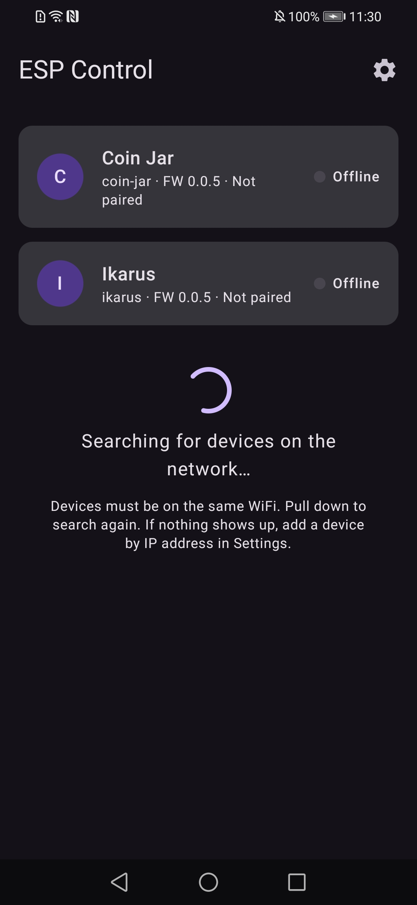
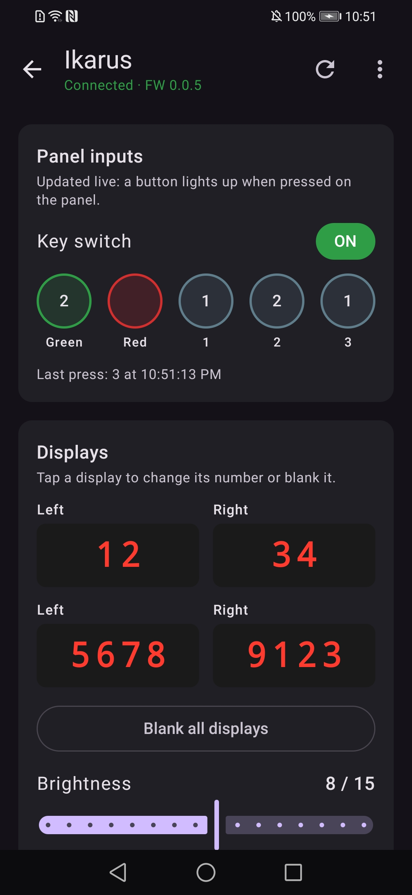
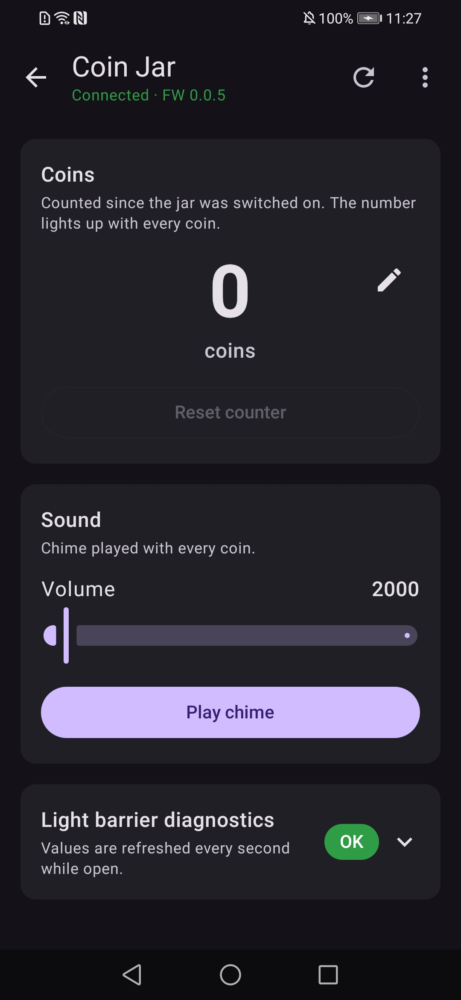
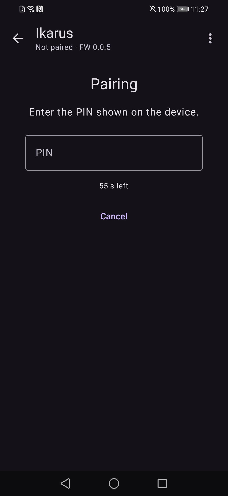
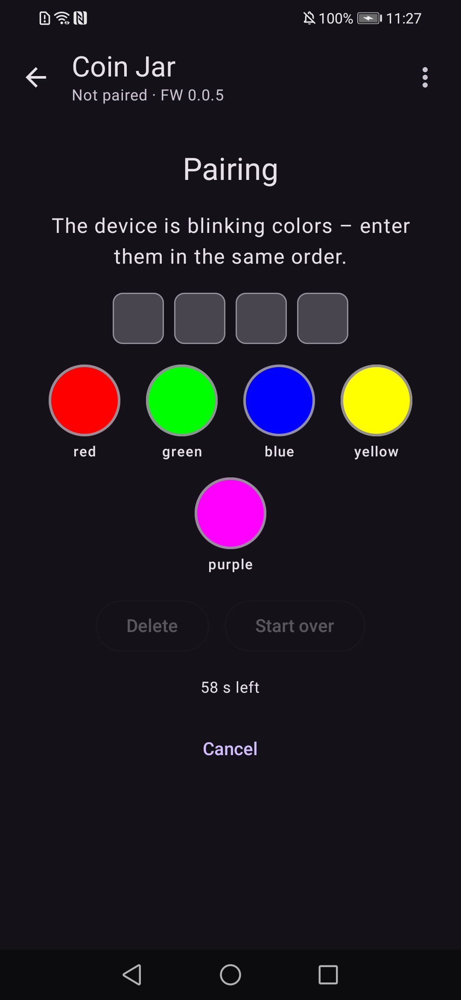
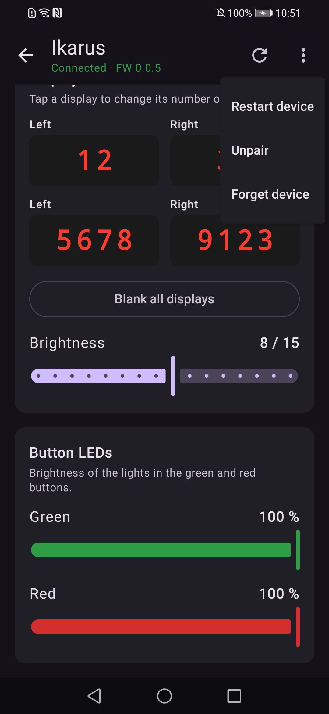

# esp-control-app

Android app that controls ESP8266 and ESP32 projects on the local WiFi network. It finds the devices automatically, pairs with them and shows a screen for every device type. The devices use the [esp-device-control](https://github.com/davidvancl/esp-device-control) library; the protocol, security model and device types are defined in its [DESIGN.md](https://github.com/davidvancl/esp-device-control/blob/main/DESIGN.md).

  

*Device list, ikarus screen and coin-jar screen.*

## Requirements

- Android 8.0 or newer
- Phone and devices on the same WiFi network
- A device with the esp-device-control library (protocol v1)

On Android 17 and newer the app asks for access to the local network on first start. Without it no device can be found or controlled.

## Supported devices

| Type | Project | Screen |
|---|---|---|
| `ikarus` | [project-ikarus](https://github.com/davidvancl/project-ikarus) | displays, display brightness, button LEDs, key switch and button presses |
| `coin-jar` | [coin-jar](https://github.com/davidvancl/coin-jar) | coin count, reset and correction, chime volume, light barrier diagnostics |
| other | – | generic list of readable values and a JSON input for every writable value |

infinity-cube-lamp and gitlab-pipeline-semaphor get their own screens once they use the library.

## Behavior

| Situation | App |
|---|---|
| Device on the network | found over mDNS (`_espctl._tcp`), shown as online |
| mDNS does not work | the last IP of every known device is checked every 10 s; a device can be added by IP address in Settings |
| Pull down on the device list | searches again over mDNS and checks every known device right away |
| First connection | pairing: enter the PIN shown on the device (digits on ikarus, a sequence of blinking colors on coin-jar), or confirm on the device; the token is stored per device |
| Device screen open | connected over WebSocket, values update live |
| App in background | connection closed, reconnects when the app returns |
| Connection lost | reconnects with backoff (1 s up to 30 s) |

Devices are identified by their chip ID, never by IP, so a new IP from DHCP does not matter.

### Pairing

The device decides how it is paired. A PIN is valid for 60 s and three wrong attempts end the pairing.

 

*Left: numeric PIN shown on the ikarus display. Right: sequence of colors blinked by the coin-jar LEDs.*

### ikarus screen

| Part | Control |
|---|---|
| Panel inputs | key switch ON / OFF, buttons light up when pressed, press count and time of the last press |
| Displays | tap a display to enter a number or blank it; "Blank all displays" button |
| Display brightness | slider 0–15 |
| Button LEDs | green and red slider 0–100 % |

### coin-jar screen

| Part | Control |
|---|---|
| Coins | count since the jar was switched on, animated with every coin; pencil to correct the count, "Reset counter" with confirmation |
| Sound | volume slider 0–32767, "Play chime" plays the coin effect |
| Light barrier diagnostics | collapsible: barrier OK / not working, current and idle value (0–4095), refreshed every second while open |

Pairing: the LEDs blink 4 colors in a loop; tap the colored buttons in the same order. Every color is labelled with its name for color-blind users.

### All devices

Sliders send at most one change per 100 ms. The device menu (⋮) has Restart device (with confirmation), Unpair and Forget device.



*Device menu, below it the ikarus display brightness and button LEDs.*

## Settings

- Add a device by IP address, when it is not found automatically
- Known devices with their IP, Remove forgets a device in the app only (Forget device in the device menu also unpairs it on the device)

## Build and install

Requires Android Studio (or its bundled JDK and the Android SDK).

```
./gradlew :app:assembleDebug
adb install app/build/outputs/apk/debug/app-debug.apk
```

Unit tests and lint:

```
./gradlew :app:testDebugUnitTest :app:lintDebug
```

The app logs mDNS discovery under the tag `EspDiscovery`:

```
adb logcat -s EspDiscovery
```

## Source layout

Package `com.davidvancl.espcontrol`:

- `protocol/Messages.kt` – protocol v1 messages and JSON encoding
- `net/WsConnection.kt` – WebSocket connection (OkHttp), behind the `DeviceConnection` interface
- `net/Discovery.kt` – mDNS discovery (NsdManager)
- `data/KnownDeviceStore.kt` – known devices and their tokens (DataStore)
- `data/DeviceRepository.kt` – known and discovered devices, online status
- `device/DeviceSession.kt` – one connection: hello, requests, events, pairing, reconnecting
- `ui/list/` – device list and settings
- `ui/device/` – device screen, pairing (numeric and symbol PIN), `IkarusScreen`, `CoinJarScreen`, `GenericDeviceScreen`, shared controls in `Controls.kt`
- `res/values-cs/` – Czech translation (English is the default)

A new device type gets its table in DESIGN.md first, then its screen in `ui/device/` and a branch in `DeviceScreen.kt`.

## Releasing a new version

1. Increase `appVersion` in [app/build.gradle.kts](app/build.gradle.kts).
2. Commit and push to `main`.
3. GitHub Actions run the tests and lint, build a signed APK and publish it as release `v<version>`.

Pushes that do not change the version build nothing. Do not push a locally changed version unless you want to publish a release.

### Release signing (once)

All releases must be signed with the same key, otherwise Android refuses to install an update over the previous version. Create the key once and keep the file and passwords safe outside the repository (`*.jks` is in `.gitignore`):

```
keytool -genkeypair -keystore esp-control-release.jks -alias esp-control -keyalg RSA -keysize 4096 -validity 10000
```

Add it as repository secrets (Settings → Secrets and variables → Actions), e.g. with the GitHub CLI:

```
base64 -w0 esp-control-release.jks | gh secret set ANDROID_KEYSTORE_BASE64
gh secret set ANDROID_KEYSTORE_PASSWORD
gh secret set ANDROID_KEY_ALIAS --body esp-control
gh secret set ANDROID_KEY_PASSWORD
```

## License

[MIT](LICENSE)
